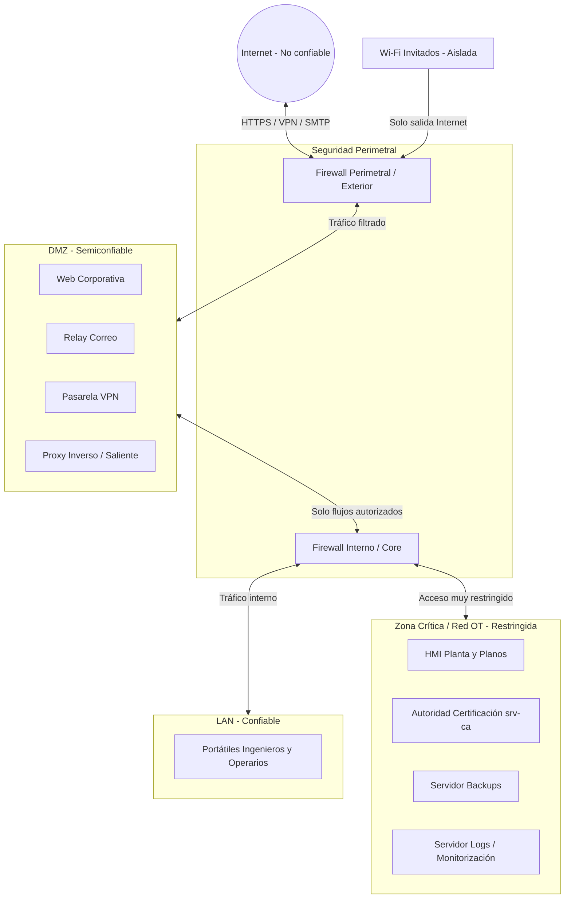

# Práctica 1 · Perímetro y zonas
**Módulo:** 0378 Seguridad y Alta Disponibilidad (2º ASIX)  
**Resultado de Aprendizaje:** RA3 (criterios a, b y c)  
**Empresa:** Torrent S.L.

---

## 1. Arquitectura de zonas y ubicación de servicios

Además de las zonas base propuestas (**Internet**, **DMZ**, **LAN** y **Zona Crítica**), se han definido dos zonas adicionales por necesidades de segmentación y seguridad:
* **Zona de Invitados (VLAN aislada):** Para separar el tráfico de dispositivos externos no gestionados (Wi-Fi de invitados) de la red corporativa, dándoles salida directa a Internet sin visibilidad interna.
* **Red OT / Industrial (Planta):** Para aislar los sistemas de control industrial (HMI) de la red ofimática (IT/LAN), evitando que un fallo o malware en la oficina paralice la producción física.

### Tabla de ubicación y protocolos

| Servicio | Zona | Protocolo(s) principal(es) | Justificación |
| :--- | :--- | :--- | :--- |
| **1. Web corporativa pública** | DMZ | HTTPS (TCP 443) | Debe ser accesible desde Internet por cualquier cliente, pero aislada de la LAN por si sufre un ataque web. |
| **2. Servidor de correo** | DMZ (Relay) / LAN (Buzones) | SMTPS (TCP 465/587), IMAPS (TCP 993) | El relay de entrada/salida debe estar expuesto en DMZ para recibir correo externo, manteniendo los buzones internos protegidos. |
| **3. Pasarela VPN** | DMZ (o Perímetro FW) | WireGuard (UDP 51820) / OpenVPN (UDP 1194) | Necesita recibir conexiones cifradas desde Internet para autenticar trabajadores remotos antes de darles paso a la red interna. |
| **4. Proxy (saliente e inverso)** | DMZ | HTTP/HTTPS (TCP 80, 443, 3128) | El inverso protege y filtra peticiones entrantes hacia servidores web, y el saliente controla y cachea la navegación de la LAN hacia Internet. |
| **5. HMI de planta y carpeta de planos** | Red OT / Zona Crítica | OPC-UA, Modbus/TCP, SMBv3 (cifrado) | Manejan maquinaria crítica y propiedad intelectual; requieren aislamiento estricto respecto a Internet y a la red ofimática general. |
| **6. Autoridad de certificación (srv-ca)** | Zona Crítica | HTTPS / SCEP / EST (solo interno) | Si la CA raíz es comprometida se rompe toda la confianza criptográfica de la empresa, por lo que debe estar altamente restringida. |
| **7. Servidor de copias de seguridad** | Zona Crítica | SSH/SFTP (TCP 22), SMB/NFS cifrado | Almacena todos los datos de la empresa y debe ser inaccesible desde redes de usuarios para evitar su cifrado por *ransomware*. |
| **8. Portátiles de ingenieros y operarios** | LAN | DHCP, DNS, HTTPS, SMBv3, SSH | Son equipos de trabajo corporativos confiables que necesitan acceder a recursos internos y salir a Internet de forma controlada. |
| **9. Wi-Fi de invitados** | Zona de Invitados | HTTP/HTTPS (TCP 80/443), DNS (UDP 53) | Son dispositivos externos no confiables que solo necesitan salida a Internet y deben estar totalmente aislados de la LAN y la DMZ. |
| **10. Servidor de registros y monitorización** | Zona Crítica | Syslog TLS (TCP 6514), SNMPv3 (UDP 161) | Centraliza evidencias de seguridad de toda la red; debe estar blindado para que un atacante no pueda borrar sus rastros. |

---

## 2. Tabla de flujos entre zonas

| Origen → Destino | ¿Permitido? | Ejemplo concreto |
| :--- | :--- | :--- |
| **Internet → DMZ** | **Sí (Restringido)** | Un cliente accede por `HTTPS (443)` a la web corporativa o un teletrabajador inicia un túnel `VPN (UDP 51820)` contra la pasarela. |
| **Internet → LAN** | **No** | Cualquier intento de conexión directa desde el exterior hacia los portátiles o servidores internos es descartado por defecto (*Deny All*). |
| **DMZ → LAN** | **No (Salvo excepciones muy tasadas)** | Por norma general está bloqueado para evitar pivotes si comprometen la DMZ; solo se permite tráfico muy específico como el envío de logs (`Syslog TLS 6514`) hacia el servidor de monitorización en Zona Crítica. |
| **LAN → DMZ** | **Sí (Controlado)** | Los portátiles de la LAN consultan el proxy saliente (`TCP 3128`) para navegar o sincronizan correo contra el servidor de correo interno/DMZ. |
| **LAN → Internet** | **Sí (A través de Proxy/FW)** | Los operarios navegan por webs externas (`HTTPS 443`) pasando obligatoriamente por el proxy de la DMZ y las reglas de filtrado del cortafuegos. |
| **LAN → Zona Crítica / OT** | **Sí (Muy restringido)** | Únicamente los portátiles de ingenieros autorizados acceden por `SMBv3` a la carpeta de planos o por `HTTPS` al HMI mediante reglas de ACL estrictas. |
| **Invitados → LAN / DMZ / Crítica** | **No** | El tráfico de la Wi-Fi de invitados tiene bloqueado el enrutamiento hacia cualquier red privada interna (RFC 1918), permitiendo solo salida hacia Internet. |

---

## 3. Diagrama de la arquitectura de red

---

## 4. Pregunta de reflexión

**Si cae (es comprometido) el servidor web, ¿qué puede hacer el atacante en tu diseño y qué se lo impide?**

Si un atacante compromete el servidor web, únicamente podrá tomar el control de dicha máquina dentro de la **DMZ**, intentar atacar a otros servicios vecinos de esa misma subred o utilizar el servidor para lanzar ataques hacia el exterior. Sin embargo, el **cortafuegos interno (FW2)** bloquea por defecto cualquier conexión iniciada desde la DMZ hacia la **LAN**, la **Red OT** y la **Zona Crítica**, impidiendo que el atacante acceda a los equipos de los ingenieros, los planos, las copias de seguridad o el control de la planta. Además, como los registros se envían en tiempo real al servidor de monitorización en la Zona Crítica, el atacante tampoco podrá borrar las evidencias de su intrusión.
